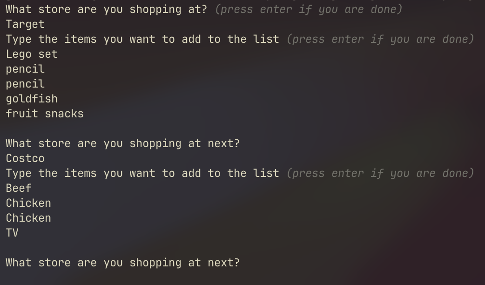
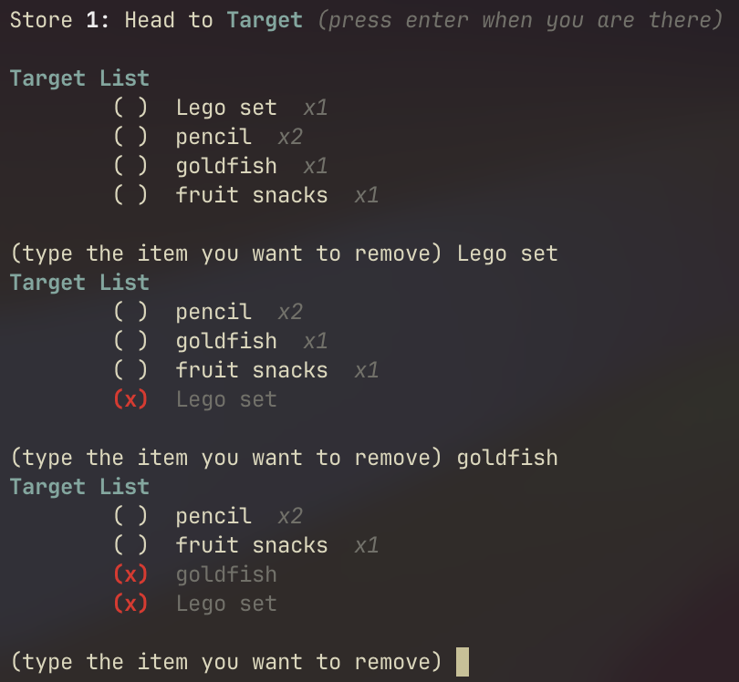
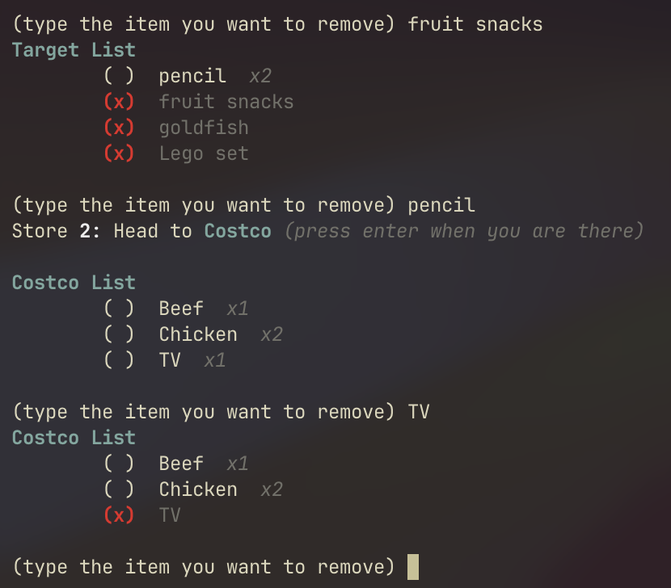

# CartHelper

A shopping list helper for shopping across multiple stores.

> **Note:** All commands below must be run from the **root directory of the repository** (`CartHelper/`).

## How to Compile and Run

### 1. Compile the program

Compile the main Java classes:

```bash
javac -d src src/com/carthelper/Main.java src/com/carthelper/LinkedChain.java src/com/carthelper/Store.java src/com/carthelper/Item.java
```

### 2. Run the program

After compiling, start CartHelper with:

```bash
java -cp src com.carthelper.Main
```

## How to Compile and Run Tests

### 1. Compile the test classes

Make sure the JUnit standalone JAR is located at `src/com/carthelper/lib/junit-platform-console-standalone-1.14.4.jar`, then run:

```bash
javac -d src -cp "src:src/com/carthelper/lib/*" \
  src/com/carthelper/MainTest.java \
  src/com/carthelper/LinkedChainTest.java \
  src/com/carthelper/StoreTest.java \
  src/com/carthelper/ItemTest.java
```

### 2. Run all tests

Run the following command to execute all four test classes:

```bash
java -jar src/com/carthelper/lib/junit-platform-console-standalone-1.14.4.jar execute \
  --class-path src \
  --select-class com.carthelper.MainTest \
  --select-class com.carthelper.LinkedChainTest \
  --select-class com.carthelper.StoreTest \
  --select-class com.carthelper.ItemTest
```

**Note:** You must compile the main classes before running the program. You must compile both the main classes and test classes before running the tests. You do not need to run the tests to use the program.

## Example Photos

Start by entering the stores and items you want to add. You can add multiple of the same item to each store.

<div align="center">
    
</div>

Then, check off the items after heading to the store it tells you to visit.

<div align="center">
    
</div>

When you have checked off every item for one store, you can head to the next store.

<div align="center">
    
</div>

## Reflection

**What changed from our specification?**

Our specification had a separate input for each item's quantity. Instead, the user types the same item again, and its count increases. We changed this so users can add items quickly without an extra step. Because of this, duplicate checking now happens through `Item.equals()`, and our tests check for duplicate items instead of invalid quantity input.

**What changed in the LinkedChain?**

We used the provided `LinkedChain` as storage for our stores and items. We used `addToEnd()` so the list stays in the order the user typed it.

**What happened to our unknowns?**

We figured out how to read input until a blank line and how to test `Main` by simulating user input. Saving the list between runs is still an open question.

**What doesn't work yet?**

Names are case-sensitive, blank names containing spaces are not rejected, and the user cannot remove an item they added by mistake.

## Next Steps

**What is left to finish the MVP?**

- Make names case-insensitive.
- Reject blank names.
- Let the user remove an item before shopping.

**Which stretch goals will we attempt?**

We will attempt saving the list to a file. We are dropping any other stretch goals to focus on the MVP.

**What new tests will we need?**

Tests for mixed-case duplicates, blank names, removing items, and saving/loading the list.

## Attribution
| File | Aneesh | Grant | Shafiur | Seth |
| --- | --- | --- | --- | --- |
| `Main.java` | Tested | Wrote | Reviewed | Reviewed |
| `Store.java` | Wrote | Revised | Reviewed | Tested |
| `Item.java` | Reviewed | Revised | Tested | Wrote |
| `LinkedChain.java` | Reviewed | Reviewed | Tested | Revised |

## How we used AI:
We utilized AI to review all of our Test classes, and asked it to make sure we thoroughly tested our Java classes. We also used AI to help us properly format our Readme file and make it in such a way that anyone can easily pull and run our code.